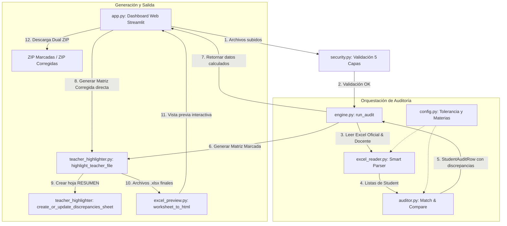

# 📊 Sistema de Auditoría de Calificaciones (Dashboard Web)

Herramienta institucional automatizada de alta precisión desarrollada para auditar, comparar y conciliar las calificaciones registradas por los docentes en sus matrices de Excel frente a los reportes oficiales generados por el sistema académico institucional (Carmenta / Ministerio de Educación).

El sistema detecta discrepancias numéricas, desfases de nómina y errores de tipeo con precisión milimétrica, inyectando estilos institucionales, comentarios emergentes de auditoría y generando dos paquetes descargables: matrices con errores visualmente marcados y matrices corregidas automáticamente.

---

## 🏗️ Arquitectura y Mapa de Componentes (`src/`)

El sistema sigue una arquitectura modular desacoplada basada en el **Principio de Responsabilidad Única (SRP)**:

```text
SistemaRevisionNotas/
├── README.md               # Documentación técnica integral
├── requirements.txt        # Dependencias de Python (streamlit, pandas, openpyxl, pyarrow)
├── logoEscuela.png         # Logotipo oficial institucional para Excel y Dashboard
├── .venv/                  # Entorno virtual de ejecución
└── files/
    ├── README.md           # Copia de documentación en directorio de trabajo
    └── src/                # Código fuente de la aplicación
        ├── app.py          # Dashboard interactivo web (Streamlit) y ciclo de vida de usuario
        ├── security.py     # Capa de seguridad multicapa (5 capas: tamaño, extensión, Magic Bytes, Zip Bomb/macros y parsing seguro)
        ├── engine.py       # Orquestador del flujo de auditoría por curso
        ├── config.py       # Catálogo centralizado: materias, tolerancias, cursos y resolución de logo
        ├── auditor.py      # Motor de normalización, matching (posición/nombre/fuzzy 85%) y comparación
        ├── excel_reader.py # Parser inteligente de libros Excel de docentes y reportes oficiales
        ├── teacher_highlighter.py # Motor de estilizado institucional, resaltado, corrección, firmas y logo
        └── excel_preview.py# Renderizador HTML fiel para previsualización web idéntica a Excel
```

### Tabla de Responsabilidades por Módulo

| Módulo | Responsabilidad Principal | Dependencias Clave |
| :--- | :--- | :--- |
| **`app.py`** | Controla la interfaz gráfica, el estado de sesión (`st.session_state`), el emparejamiento inteligente de archivos, la invocación del motor, la previsualización y la descarga de ZIPs. Captura errores amigables de estructura y celdas combinadas. | `streamlit`, `pandas`, `openpyxl` |
| **`security.py`** | Implementa 5 capas de seguridad defensiva (tamaño/memoria, extensión `.xlsx`, firma digital ZIP `PK\x03\x04`, protección contra Zip Bombs / macros ejecutables y parsing en memoria), además de sanitización contra ataques Path Traversal / Zip Slip. | `zipfile`, `openpyxl`, `io`, `re` |
| **`engine.py`** | Orquestador de lógica pura. Conecta la lectura (`excel_reader`), comparación (`auditor`) y persistencia visual (`teacher_highlighter`) para un curso individual sin depender de la UI. | `excel_reader`, `auditor`, `teacher_highlighter` |
| **`config.py`** | Fuente de verdad global. Define las materias evaluadas (`RELEVANT_SUBJECTS`), alias tolerados, nombres de columnas de nómina, tolerancia numérica (`0.02`), catálogo de cursos (`FULL_MAP`) y resolución del logotipo. | `typing.NamedTuple`, `pathlib` |
| **`auditor.py`** | Lógica CORE de datos. Normaliza nombres a texto alfanumérico puro, ejecuta emparejamiento exacto por posición/nombre, fuzzy matching optimizado (filtro rápido + umbral 85%), y calcula diferencias cuantitativas entre notas. | `difflib`, `unicodedata`, `dataclasses` |
| **`excel_reader.py`** | Lee y extrae información desde archivos `.xlsx`. Detecta dinámicamente filas de cabecera, mapea bloques de materias en reportes oficiales jerárquicos y escanea hojas por similitud de alumnos (Data-Driven Discovery). | `openpyxl`, `difflib` |
| **`teacher_highlighter.py`** | Abre el libro del docente preservando fórmulas (`data_only=False`), aplica la paleta institucional pastel, normaliza la ortografía de materias, colorea errores, inyecta comentarios 💬, añade la hoja ejecutiva, inserta el logotipo institucional en A1 y garantiza el pie de firmas. | `openpyxl`, `copy`, `re` |
| **`excel_preview.py`** | Convierte las hojas Excel procesadas en tablas HTML interactivas con texto vertical hacia arriba (`writing-mode`), soporte de celdas combinadas y tooltips dinámicos idénticos a Microsoft Excel. | `openpyxl`, `base64` |

---

## 🔄 Diagrama de Flujo e Interacción entre Módulos



---

## 🔬 Flujo Técnico Detallado y Ciclo de Vida

### 1. Emparejamiento Inteligente de Cursos (`Smart Match`)
Cuando el usuario sube múltiples archivos docentes y reportes oficiales en `app.py`:
- La función `guess_course_from_filename` normaliza el nombre del archivo (eliminando espacios, guiones y mayúsculas/minúsculas) y busca coincidencias con el catálogo `FULL_MAP` de `config.py` (ej. `8AM` -> `"octavo A"`, `"8AM Matutino"`).
- Se admiten **cargas asimétricas**: si el docente sube un archivo consolidado que contiene múltiples cursos (ej. `BS MAT ANUAL MATRIZ TUTOR.xlsx`), el sistema empareja dinámicamente cada reporte oficial contra la hoja respectiva del consolidado maestro (`CONSOLIDATED`).

### 2. Capa de Seguridad Defensiva Multicapa (`security.py`)
Antes de tocar el disco o procesar un archivo con `openpyxl`, cada flujo atraviesa cinco barreras estrictas y sanitización:
1. **Validación de Memoria y Tamaño:** Rechaza archivos de 0 bytes o que superen los 30 MB (`MAX_FILE_SIZE_BYTES`) para evitar agotamiento de memoria.
2. **Validación de Extensión y Sanitización:** Comprueba que la extensión sea `.xlsx`. La función `sanitize_filename` previene ataques de Path Traversal (Zip Slip / Directory Traversal) eliminando secuencias peligrosas (`../`, `..\`, bytes nulos), caracteres no permitidos y truncando a longitudes seguras (máx 120 caracteres).
3. **Firma Digital (Magic Bytes):** Todo archivo `.xlsx` válido es un contenedor ZIP comprimido. Se leen los primeros 4 bytes y se comprueba la presencia de la firma `PK\x03\x04` (`50 4B 03 04`). Archivos PDF, fotos o ejecutables renombrados a `.xlsx` son bloqueados inmediatamente.
4. **Inspección Profunda de ZIP (Anti Zip Bomb y Detección de Macros/Binarios):** Inspecciona las entradas internas (`infolist`):
   - Rechaza archivos con más de 2500 elementos internos (`MAX_ZIP_ENTRIES`).
   - Bloquea archivos que contengan macros incrustadas o binarios ejecutables (`vbaproject.bin`, `.exe`, `.dll`, `.bat`, `.cmd`, `.vbs`).
   - Evita descompresión explosiva (Zip Bomb): rechaza si el contenido descomprimido excede los 120 MB (`MAX_UNCOMPRESSED_MB`) o si la tasa de compresión es desproporcionada (> 100:1 con más de 10 MB).
5. **Validación Estructural Rápida:** Intenta abrir el archivo en memoria utilizando `openpyxl.load_workbook(..., read_only=True)` y comprueba que contenga al menos una hoja de cálculo válida.

### 3. Extracción y Parseo Inteligente de Hojas de Cálculo (`excel_reader.py`)

El lector resuelve dos tipos de estructuras completamente distintas:

#### A. Archivo de Docentes (Estructura Plana o con Subcabeceras)
- **Localización Dinámica de Nómina:** Busca en las primeras 150 filas palabras clave configuradas (`NOMINA`, `ESTUDIANTE`, `APELLIDOS/NOMBRES`). Para evitar falsos positivos, inspecciona las siguientes 2 a 3 filas comprobando que existan nombres reales de personas con más de 5 caracteres no numéricos.
- **Mapeo Difuso de Materias:** En la fila de cabecera encontrada, busca cada materia utilizando `TEACHER_SUBJECT_ALIASES` (tolerando variantes como `LENGUA` vs `LENGUA Y LITERATURA`, `ECA` vs `EDUCACIÓN CULTURAL Y ARTÍSTICA`) mediante coincidencia exacta/subcadena y fuzzy matching (`SequenceMatcher.ratio() >= 0.65`).
- **Filtrado de Subcabeceras y Pies de Página:** Omite automáticamente filas intermedias como `NOTA` / `CUALIT.` y filas inferiores de resumen (`PROMEDIO`, `RECTOR`, `VICERRECTOR`, `DOCENTE`, `TOTAL`).

#### B. Archivo Oficial del Sistema / Carmenta (Estructura Jerárquica de 2 Niveles)
- **Nivel Superior (Fila de Materia):** Una celda combinada (`MergedCell`) que abarca el nombre de la materia (ej. `MATEMÁTICA`) y cubre varias columnas.
- **Nivel Inferior (Subcolumnas):** Directamente debajo de la materia, se ubican subcolumnas parciales como `I`, `II`, `III` y `NOTA FINAL`.
- El algoritmo `_build_subject_header_map` mapea los rangos combinados del nivel superior y busca exclusivamente la columna que coincide con `OFFICIAL_FINAL_GRADE_LABEL = "NOTA FINAL"`.
- Las columnas planas como `P.GENERAL` que no tienen subcolumnas son detectadas automáticamente.

#### C. Escaneo Inteligente de Hojas (`Data-Driven Discovery`)
Si el nombre de la hoja en el archivo docente no coincide con el estándar esperado (ej. la hoja se llama `"Hoja 1"` o `"Matriz Final Anual"` en lugar de `"octavo A"`):
- `_get_sheet` realiza un escaneo fonético cruzando los nombres de los estudiantes del reporte oficial contra cada hoja del libro docente. La hoja que tenga mayor cantidad de coincidencias (mínimo 3 estudiantes) es seleccionada automáticamente.

---

### 4. Algoritmo de Emparejamiento de Alumnos (`auditor.py`)

Para garantizar que un error en el orden de la lista o un estudiante retirado no desplace las notas de los demás alumnos:

```text
[Estudiante Docente: "JUAN CARLOS PÉREZ"]  -->  normalize_name()  -->  "JUANCARLOSPEREZ"
[Estudiante Oficial: "PÉREZ JUAN CARLOS"]  -->  normalize_name()  -->  "PEREZJUANCARLOS"
                                                                               │
       ┌───────────────────────────────────────────────────────────────────────┘
       ▼
1. ¿Misma posición y nombres normalizados iguales? ──► SÍ ──► MATCHED_BY_POSITION
       │ NO
       ▼
2. ¿Coincidencia exacta por nombre en sistema?     ──► SÍ ──► MATCHED_BY_NAME (Desfase)
       │ NO
       ▼
3. ¿Filtro quick_ratio() >= 0.80?                  ──► NO ──► Descarte inmediato O(len)
       │ SÍ
       ▼
4. ¿Similitud difusa ratio() >= 0.85?              ──► SÍ ──► MATCHED_WITH_TYPO
       │ NO
       ▼
5. Clasificar: ONLY_IN_TEACHERS  o  ONLY_IN_OFFICIAL
```

* **Normalización Alfanumérica Pura:** `normalize_name()` pasa el texto a mayúsculas, remueve diacríticos/tildes mediante descomposición Unicode (`NFKD`) y elimina absolutamente todos los espacios, guiones, puntos y caracteres especiales, dejando solo caracteres `[A-Z0-9]`.
* **Optimización de Rendimiento:** Antes de calcular matrices completas con `difflib.SequenceMatcher.ratio()`, se evalúa `quick_ratio() < 0.80`. Esto reduce drásticamente el uso de CPU descartando al instante comparaciones entre estudiantes sin relación.
* **Tolerancia a Errores Tipográficos (Typos):** Con un umbral de similitud difusa del 85% (`best_score >= 0.85`), el sistema empareja exitosamente nombres que contengan letras omitidas o cambiadas por error de tipeo.

---

### 5. Comparación Cuantitativa y Detección de Discrepancias

Por cada estudiante emparejado, se comparan las calificaciones materia por materia:

$$\Delta = |\text{Nota Docente} - \text{Nota Sistema}|$$

* **Criterio de Tolerancia Institucional (`TOLERANCE = 0.02`):** Si $\Delta \le 0.02$, la nota se considera válida (`GradeStatus.OK`), absorbiendo variaciones normales de redondeo entre fórmulas de Excel (`=TRUNC(...)`) y sistemas web.
* **Discrepancia Numérica (`GradeStatus.ERROR`):** Si $\Delta > 0.02$, se registra una inconsistencia crítica con la nota del docente, la oficial y el diferencial exacto.
* **Notas Nulas o Vacías:**
  * Si ambas celdas están vacías o no numéricas, se categoriza como `GradeStatus.SIN_DATO` (no se considera error).
  * Si una celda está en blanco en docentes pero tiene nota oficial (o viceversa), se categoriza como `GradeStatus.ERROR` indicando `"Falta nota en Docente"` o `"Falta nota en Sistema"`.

---

### 6. Motor de Estilizado y Persistencia en Excel (`teacher_highlighter.py`)

#### A. Preservación Estricta de Fórmulas y Celdas Combinadas
El libro de docentes se carga con `load_workbook(..., data_only=False)`. Esto garantiza que fórmulas institucionales nativas como `=TRUNC(AVERAGE(D8:J8),2)` o `=PROMEDIO(...)` **no se pierdan ni se conviertan en texto plano**, preservando el cálculo dinámico del libro.

#### B. Paleta Institucional Canónica (ARGB 100% Opaco)
Para asegurar que Microsoft Excel y LibreOffice muestren los colores con total solidez sin transparencias no deseadas, todos los estilos utilizan el canal alfa `FF` (8 caracteres hexadecimales):

* **Encabezados y Columnas de Materias (Colores Oficiales):**
  * `LENGUA Y LITERATURA`: Azul pastel (`FFB4C6E7`).
  * `MATEMÁTICA`: Celeste pastel (`FF94DCF8`).
  * `CIENCIAS NATURALES`: Amarillo pastel (`FFFFE598`).
  * `ESTUDIOS SOCIALES`: Durazno pastel (`FFF7CAAC`).
  * `INGLÉS`: Lavanda suave (`FFDEEAF6`).
  * `EDUCACIÓN CULTURAL Y ARTÍSTICA / ECA`: Gris suave (`FFD0CECE`).
  * `EDUCACIÓN FÍSICA`: Dorado / Ámbar (`FFFFD966`).
  * `ANIMACIÓN A LA LECTURA`: Turquesa claro (`FFA0FCF3`).
  * `CAI / CÍVICA Y ACOMPAÑAMIENTO INTEGRAL`: Amarillo claro (`FFF8FF9D`).
  * `ORIENTACIÓN VOCACIONAL`: Verde claro (`FFB6D7A8`).
  * `PROMEDIO FINAL / PROMEDIO`: Verde institucional (`FF92D050`).
  * `COMPORTAMIENTO`: Violeta suave (`FFCC99FF`).
  * `PROMOCIÓN / OBSERVACIONES`: Gris institucional (`FFBFBFBF`).
  * `N° / CÉDULA / NÓMINA`: Gris de estructura (`FFD8D8D8`).

* **Marcado de Auditoría (Solo en "Descargar Errores Resaltados"):**
  * **Estudiante con discrepancia:** Nombre del alumno resaltado en Ámbar suave (`FFFFF2CC`).
  * **Nota con discrepancia:** Celda numérica resaltada en Coral / Rojo suave (`FFF1948A`).
  * **Comentario Emergente 💬:** Se adjunta un objeto `openpyxl.comments.Comment` sobre la celda que muestra:
    ```text
    Sistema: 8.50
    Diferencia: 0.15
    ```

#### C. Normalización Ortográfica Canónica y Subfilas `NOTA` / `CUALIT.`
La función `_apply_institutional_colors_to_sheet` corrige inconsistencias tipográficas en caliente:
- Corrige textos sin tildes (`INGLES` -> `INGLÉS`, `MATEMATICA` -> `MATEMÁTICA`).
- Corrige textos cortados (`ANIM\nACIÓ` -> `ANIMACIÓN A LA LECTURA`).
- Corrige columnas finales duplicadas (`PROMEDIO` -> `PROMOCIÓN`).
- Elimina saltos de línea `\n` molestos en encabezados verticales (`textRotation=90`).
- **Subfila de Notas:** Si la matriz contiene doble columna por materia (número y cualitativa), estandariza automáticamente la subfila en `NOTA` y `CUALIT.` con texto centrado, negrita y el color pastel de su materia. Si la matriz es de 1 sola fila por materia, no añade filas artificiales.

#### D. Logotipo Oficial de la Escuela en Cada Hoja
La función `_ensure_school_logo_in_sheet` localiza automáticamente el archivo `logoEscuela.png` mediante `config.get_school_logo_path()` e inserta la imagen escalada institucionalmente (ancho: 80 px, alto: 93 px) anclada en la celda **`A1`** de cada hoja generada (excepto la hoja de resumen).

#### E. Preservación e Inserción de Firmas de Autoridades
La función `_ensure_footer_in_sheet` audita la zona inferior de la hoja:
1. **Detección Previa:** Escanea hasta 15 filas por debajo del último estudiante buscando palabras como `Rectora`, `Vicerrectora` o `Tutor`. Si ya existe un pie de firmas con formatos y celdas combinadas originales, **no lo toca ni modifica**, únicamente ajusta las fuentes a tamaño 12 institucional.
2. **Generación Automática:** Si no existe pie de página, deja 4 filas de separación reglamentarias e inserta las firmas oficiales según la jornada:
   * **Rectora:** `Ing. Sonia Chicaiza Mgtr.` / `Rectora (e)`.
   * **Vicerrectora:** `Lcda. Isabel Carpio Mgtr.` (Matutina) o `Lcda. Lucia Uzhca Mgtr.` (Vespertina).
   * **Docente Tutor:** Extraído heurísticamente del encabezado o pie de la matriz mediante `_extract_tutor_from_source` y normalizado con `_clean_tutor_name`.

#### F. Hoja Ejecutiva "RESUMEN DISCREPANCIAS"
Se inserta en la posición `0` (al inicio del libro) una tabla ejecutiva con estética institucional (cabecera azul marino `#1E3A8A`):
- Agrupa todas las inconsistencias encontradas por curso y por estudiante.
- Indica claramente con emojis: `❌ ERROR DE NOTA`, `⚠️ FALTA EN SISTEMA` o `⚠️ FALTA EN DOCENTE`.
- Muestra el valor asentado por el docente frente al valor oficial de Carmenta.

---

### 7. Previsualización Fiel en la Web (`excel_preview.py`)

Permite al usuario inspeccionar el archivo generado sin necesidad de abrir Microsoft Excel:
- Lee las celdas directamente del `.xlsx` procesado.
- Replica celdas combinadas (`rowspan`, `colspan`).
- Detecta rotación de texto (`textRotation=90`) y aplica estilos CSS:
  ```css
  writing-mode: vertical-rl;
  transform: rotate(180deg);
  ```
- Convierte comentarios de auditoría en badges interactivos `💬` con tooltip nativo (`title="..."`).
- Inserta el logotipo en base64 en la celda A1 para simular fielmente el libro de Excel.

---

### 8. Salida y Descarga Dual Volátil (`ZIP`)

La aplicación genera dos paquetes independientes en memoria (`io.BytesIO`):

1. **`Resultados_Errores_Marcados.zip`:** Contiene las matrices con los estudiantes en amarillo (`FFFFF2CC`), las notas erróneas en rojo (`FFF1948A`), notas emergentes explicativas, el logotipo institucional y la hoja `RESUMEN DISCREPANCIAS`. Ideal para retroalimentación a profesores.
2. **`Resultados_Matrices_Corregidas.zip`:** Contiene las matrices con **todos los colores institucionales intactos**, los alumnos sin marcas amarillas y las notas corregidas automáticamente con el valor del sistema oficial (sin marcas rojas ni comentarios). Lista para impresión o archivo final.
3. **Limpieza Inmediata:** Una vez generados los buffers de descarga, el directorio temporal físico se destruye con `shutil.rmtree` y se ejecuta `gc.collect()` para liberar la memoria RAM.

---

### 9. Manejo Defensivo de Errores en la Interfaz (`app.py`)

Si un archivo presenta anomalías estructurales, la aplicación no colapsa silenciosamente; atrapa excepciones específicas y presenta recomendaciones en pantalla:
- **`ExcelStructureError`:** Advierte si faltan columnas esenciales como la nómina de estudiantes o materias clave.
- **`AttributeError (MergedCell)`:** Detecta cuando una celda combinada inesperada impide escribir o aplicar formato, orientando al usuario a descombinarla en Excel.

---

## 📦 Modelos de Datos Internos (`Data Structures`)

Definidos en [`files/src/auditor.py`](file:///Users/morocho/Downloads/Escuela/SistemaRevisionNotas/files/src/auditor.py) y [`files/src/config.py`](file:///Users/morocho/Downloads/Escuela/SistemaRevisionNotas/files/src/config.py) con tipado estático exacto:

```python
# auditor.py
from dataclasses import dataclass, field
from enum import Enum

class GradeStatus(str, Enum):
    OK = "OK"
    ERROR = "ERROR"
    SIN_DATO = "SIN DATO"  # Nota vacía o no convertible en una o ambas fuentes

class StudentMatchStatus(str, Enum):
    MATCHED_BY_POSITION = "MATCHED_BY_POSITION"  # Misma posición, mismo nombre normalizado
    MATCHED_BY_NAME = "MATCHED_BY_NAME"          # Desfase de posición, encontrado por nombre
    MATCHED_WITH_TYPO = "MATCHED_WITH_TYPO"      # Encontrado con similitud difusa (typo >= 0.85)
    ONLY_IN_TEACHERS = "ONLY_IN_TEACHERS"        # Existe solo en el Excel de docentes
    ONLY_IN_OFFICIAL = "ONLY_IN_OFFICIAL"        # Existe solo en el Excel oficial

@dataclass
class Student:
    raw_name: str           # Nombre original tal como aparece en Excel
    normalized_name: str    # Nombre normalizado alfanumérico (ej. "JUANPEREZ")
    row_index: int          # Índice secuencial (0-based)
    excel_row: int | None = None  # Número de fila física en Excel
    grades: dict[str, object] = field(default_factory=dict)  # Materia -> valor crudo

@dataclass
class ComparisonResult:
    subject_key: str        # Clave interna (ej. "matematica")
    subject_display: str    # Nombre legible (ej. "Matemática")
    teacher_grade: float | None
    official_grade: float | None
    difference: float | str | None  # Diferencia cuantitativa o mensaje de falta de nota
    status: GradeStatus     # OK, ERROR o SIN_DATO

@dataclass
class StudentAuditRow:
    student_name: str
    match_status: StudentMatchStatus
    excel_row: int | None = None
    comparisons: list[ComparisonResult] = field(default_factory=list)

    @property
    def has_error(self) -> bool:
        return any(c.status == GradeStatus.ERROR for c in self.comparisons)

    @property
    def has_desfase(self) -> bool:
        return self.match_status in (
            StudentMatchStatus.MATCHED_BY_NAME,
            StudentMatchStatus.MATCHED_WITH_TYPO,
            StudentMatchStatus.ONLY_IN_TEACHERS,
            StudentMatchStatus.ONLY_IN_OFFICIAL,
        )
```

---

## 💻 Guía de Inicio Rápido (Para Desarrolladores y Usuarios)

### 1. Requisitos Previos
* **Python 3.10** o superior instalado en el sistema.
* Dependencias registradas en [`requirements.txt`](file:///Users/morocho/Downloads/Escuela/SistemaRevisionNotas/requirements.txt):
  - `streamlit==1.42.0`
  - `pandas==2.2.3`
  - `openpyxl==3.1.5`
  - `pyarrow==19.0.0`

### 2. Instalación y Preparación del Entorno
Desde la raíz del repositorio:

```bash
# Crear el entorno virtual
python3 -m venv .venv

# Activar el entorno virtual
# En macOS / Linux:
source .venv/bin/activate
# En Windows:
# .venv\Scripts\activate

# Instalar dependencias requeridas
pip install -r requirements.txt
```

### 3. Ejecutar la Aplicación Web
Navega a la carpeta de código fuente e inicia el servidor Streamlit:

```bash
cd files/src
streamlit run app.py
```

Streamlit iniciará el servidor local y abrirá automáticamente tu navegador en:
```text
http://localhost:8501
```

### 4. Flujo de Trabajo en Pantalla
1. En **"1. Docente(s)"**, arrastra o sube los archivos de notas de los profesores (pueden ser matrices individuales como `4AM.xlsx`, `6BM.xlsx` o el consolidado maestro `BS MAT ANUAL MATRIZ TUTOR.xlsx`).
2. En **"2. Reportes Oficiales"**, sube los reportes anuales descargados de Carmenta (ej. `4AM.xlsx`, `6BM.xlsx`, `8AM.xlsx`).
3. Haz clic en el botón azul **"🚀 Ejecutar Auditoría"**.
4. Inspecciona la **Vista Previa en Vivo** y el **Resumen de Errores** directamente en el dashboard.
5. Descarga los resultados mediante los botones verdes:
   - `📥 Descargar Errores Resaltados (ZIP)`
   - `📥 Descargar Matrices Corregidas (ZIP)`

---

## ⚙️ Mantenimiento y Extensibilidad

### ¿Cómo agregar o renombrar una materia?
Modifica exclusivamente el archivo [`files/src/config.py`](file:///Users/morocho/Downloads/Escuela/SistemaRevisionNotas/files/src/config.py):
1. Agrega la materia a `RELEVANT_SUBJECTS` con su nombre exacto en docentes y en el sistema oficial.
2. Agrega sus alias posibles en `TEACHER_SUBJECT_ALIASES` para tolerar abreviaturas de profesores.
3. Asigna su nombre legible en `SUBJECT_DISPLAY_NAMES`.

### ¿Cómo ajustar la tolerancia de auditoría?
En [`files/src/config.py`](file:///Users/morocho/Downloads/Escuela/SistemaRevisionNotas/files/src/config.py), modifica la constante `TOLERANCE`:
```python
TOLERANCE: float = 0.02  # Por defecto 0.02 puntos de tolerancia
```

---
*Desarrollado para la optimización administrativa y el aseguramiento de la integridad académica institucional.*
